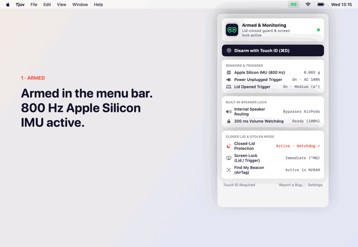
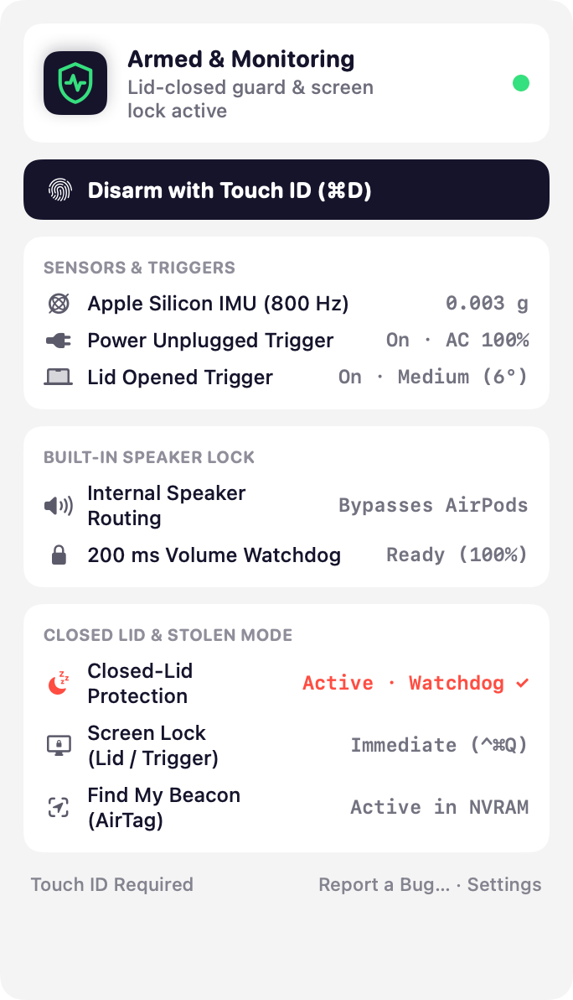
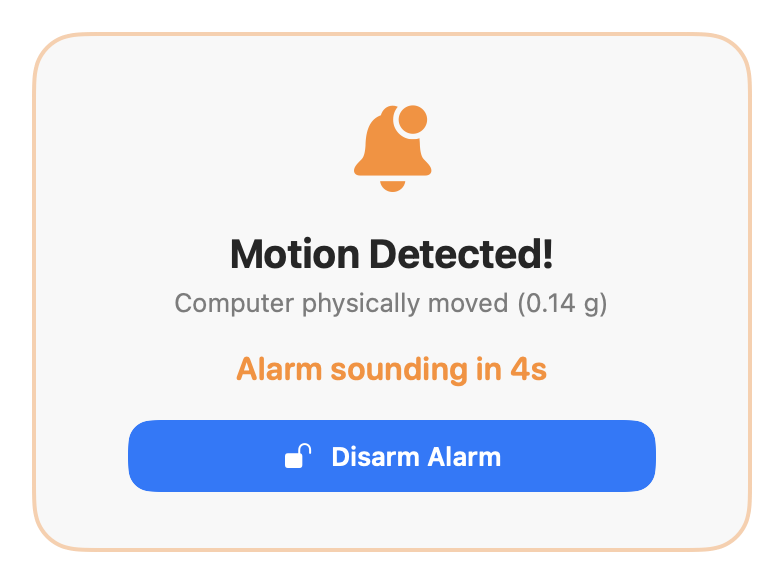
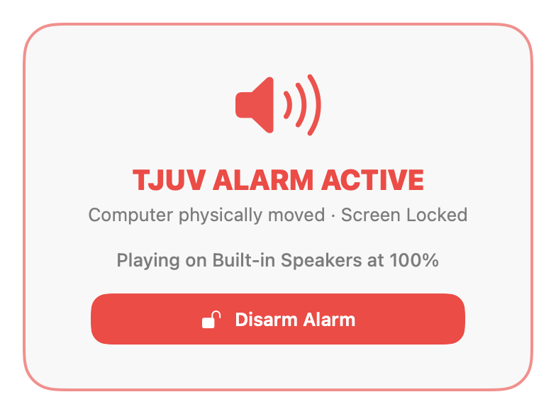

# 🛡️ Tjuv

**Touch my MacBook. Everybody hears it.** Walking away for two minutes in a café, library or
airport lounge? Arm your MacBook into an 800 Hz motion-sensing alarm that locks your screen and
blasts a 100% siren through the built-in speakers—even with AirPods connected or the lid closed.

Tjuv (Swedish/Norwegian for *"thief"*) is a small macOS menu bar app that reads your MacBook's
internal Apple Silicon accelerometer (`AppleSPUHIDDevice`), power state and lid switch, gives you a
short Touch ID countdown if you bump your own table, and otherwise makes stealing your laptop as
loud and locked-down as possible.

<p align="center">
  
</p>

**[Website](https://mj0lken.github.io/tjuv/)** ·
**[Download for Apple Silicon](https://github.com/mj0lken/tjuv/releases/latest)** ·
**[Check compatibility](https://mj0lken.github.io/tjuv/#compat)** · macOS 15 or later · free
and open source (MIT)

## Install

**Homebrew:**

```bash
brew install --cask mj0lken/tap/tjuv
```

**Or download it:**

1. Download `tjuv-…-arm64.zip` from the
   [latest release](https://github.com/mj0lken/tjuv/releases/latest), unzip it, and drag
   **Tjuv.app** to **Applications**.
2. Open it (also after a Homebrew install). The app isn't signed with a paid Apple Developer ID yet,
   so macOS stops it the first time: click **Done**, open **System Settings › Privacy & Security**,
   scroll down and click **Open Anyway** next to Tjuv. You only do this once.
3. Click the shield in your menu bar to test the 1.5-second siren, set up closed-lid protection,
   and arm your MacBook (`⌘A`).

Not sure your Mac qualifies? The [compatibility check](https://mj0lken.github.io/tjuv/#compat)
looks at your chip and macOS version in the browser, or run `sw_vers -productVersion; uname -m` in
Terminal: you need 15 or higher, and `arm64`.

Prefer to build it yourself? See [Build and run](#build-and-run).

<p align="center">
  
  &nbsp;
  
  &nbsp;
  
</p>

## What triggers the alarm

| Sensor / Trigger | How it works | Default |
|------------------|--------------|---------|
| **800 Hz Apple Silicon IMU** | Reads 3-axis acceleration & tilt directly from `AppleSPUHIDDevice` (`UsagePage 0xFF00`, `Usage 0x03`). Filters micro-vibrations and triggers when linear acceleration or 3D vector tilt exceeds your threshold (**High**: `0.04 g` / `3°`, **Medium**: `0.08 g` / `6°`, **Low**: `0.16 g` / `12°`). | On |
| **Power Unplugged** | Watches `IOPSNotificationCreateRunLoopSource` for a transition from AC power to battery. | On |
| **Lid Opened** | Polls `IOPMrootDomain` (`AppleClamshellClosed`) at 2 Hz and trips if a closed lid is opened while armed. | On |
| **System / Screen Wake** | Listens for `NSWorkspace.didWakeNotification` and `screensDidWakeNotification`. | On |

## How it counters a thief

- **Polite countdown first.** When a sensor trips, Tjuv plays gentle 1046 Hz countdown beeps (3, 5
  or 10 seconds) and displays a floating HUD over all spaces—including the lock screen—so you can
  disarm with Touch ID if you bumped your own desk.
- **Built-in speakers only.** A thief wearing AirPods or plugging in a dummy headphone adapter
  won't silence the siren. Tjuv queries CoreAudio HAL for `kAudioDeviceTransportTypeBuiltIn`, binds
  its `AVAudioEngine` output unit directly to the internal MacBook speakers, and switches system
  default output to match.
- **100% volume & unmute watchdog.** Every 200 ms while the siren is active, Tjuv forces hardware
  unmute and resets `kAudioHardwareServiceDeviceProperty_VirtualMainVolume` + scalar volume to
  `1.0`. Mashing the Mute or Volume Down keys does nothing.
- **Immediate screen lock (`⌃⌘Q`).** Using `SACLockScreenImmediate` from the login framework, Tjuv
  locks your macOS session the instant a trigger trips—or the moment you close the lid while
  armed—so a thief never gets an unlocked desktop.
- **Touch ID / passcode disarm.** Disarming (`⌘D` or the floating HUD button) requires biometric
  or local password authentication via `LocalAuthentication`.

## Closed-lid mode & AirTag tracking

Normally a MacBook sleeps the moment you close the lid, silencing apps and sensors. The only switch
that stops lid sleep on macOS is the root-only `SleepDisabled` setting (`pmset -a disablesleep 1`).

Clicking **Set Up Closed-Lid Mode…** asks for your admin password once and installs a
`visudo`-validated rule at `/etc/sudoers.d/tjuv`. That rule lets your account run only two exact
commands without a password:

```text
/usr/bin/pmset -a disablesleep 0
/usr/bin/pmset -a disablesleep 1
```

Tjuv turns lid sleep off **only while armed**, and turns it back on:

- when you disarm (`⌘D`),
- when the battery drops to 8% on battery power (hardware battery guard),
- when you quit,
- within about 5 seconds if the app crashes or is killed (a dead-man's switch watchdog process),
- on the next launch, if a previous run left it off.

It tracks ownership (`lidSleepDisabledByTjuv`) so it never touches a `SleepDisabled` that another
app (such as [thumbs-out](https://github.com/mj0lken/thumbs-out)) turned on. **Remove Closed-Lid
Setup…** turns lid sleep back on and deletes `/etc/sudoers.d/tjuv`.

### Acting as an Apple AirTag if stolen

Every Apple Silicon MacBook has a built-in hardware equivalent to an Apple AirTag: when **Find My
Mac** and **Find My network** are enabled in **System Settings › [Your Name] › iCloud › Find My
Mac**, the internal Bluetooth/SPU controller broadcasts rotating P-224 encrypted Offline Finding
beacons that any nearby iPhone, iPad or Mac relays to iCloud—even when the Mac is offline, asleep
or powered off.

Third-party macOS apps cannot spoof custom Offline Finding BLE packets through `CoreBluetooth`
(macOS strips `0x004C` manufacturer data and randomizes the BLE MAC address), so the native
hardware beacon is strictly stronger. Tjuv checks `IODeviceTree:/options` (`fmm-mobileme-token-FMM`
in NVRAM) and warns you in the menu bar if Find My Mac is off, with a one-click shortcut to enable
it. And because closed-lid mode keeps the Mac awake while armed, a stolen MacBook in a backpack
stays connected to Wi-Fi and updates its live location continuously.

## Updates

Tjuv checks [GitHub's latest release](https://github.com/mj0lken/tjuv/releases/latest) once a day.
When a newer version is out, a notice appears at the top of the menu bar menu (`brew upgrade --cask
tjuv` for Homebrew installs, or a link to the release page). Nothing is installed automatically.

## Report a bug

Click **Report a Bug…** in the menu bar to open a new
[GitHub issue](https://github.com/mj0lken/tjuv/issues) pre-filled with your Tjuv version, macOS
version, IMU/speaker availability, closed-lid setup state, and Find My NVRAM status. Your home
folder is redacted to `~`, your username to `<user>`, and your hostname to `<host>` before the page
opens.

## Build and run

Requires an Apple Silicon MacBook with macOS 15+, and Xcode (Swift 6) to build.

```bash
./scripts/build-app.sh            # builds build/Tjuv.app
./scripts/build-app.sh --install  # copies it to /Applications and launches it
swift test                        # runs the test suite
swift build && .build/debug/Tjuv --render-site docs/images   # renders site panels, icon, demo GIF & social preview
```

Cutting a release (maintainers):

```bash
./scripts/release.sh 1.0.0 --dry-run   # runs tests, builds, zips, checks cask style and writes release notes
./scripts/release.sh 1.0.0             # publishes the GitHub release, verifies the uploaded zip and updates homebrew-tap
```

## Project layout

```text
Sources/Tjuv/
  Audio/AudioController.swift      CoreAudio built-in speaker binding, 200 ms volume lock & siren synthesis
  Sensors/MotionDetector.swift     800 Hz Apple Silicon IMU (AppleSPUHIDDevice) 3-axis motion & tilt detector
  Sensors/SystemTriggers.swift     Power adapter, clamshell lid & wake triggers
  Power/LidSleepHelper.swift       visudo-validated sudoers rule & crash watchdog script
  Power/SleepManager.swift         IOPM power assertions & ownership-tracked pmset disablesleep controller
  Security/AuthManager.swift       Touch ID & local passcode authentication
  Security/ScreenLocker.swift      Immediate session lock (SACLockScreenImmediate) & lid-lock state machine
  Security/FindMyDetector.swift    NVRAM check for macOS Find My (native AirTag Offline Finding beacon)
  Core/AlarmCoordinator.swift      Central state machine (Disarmed -> Arming -> Armed -> Countdown -> Alarm)
  Core/UpdateChecker.swift         Daily GitHub release checker
  Core/LaunchAtLogin.swift         SMAppService login item wrapper
  Core/IssueReport.swift           Redacted pre-filled GitHub issue builder
  UI/StatusBarController.swift     Menu bar controller & diagnostics
  UI/FloatingAlertHUD.swift        Lock-screen-visible countdown & alarm overlay
  UI/TjuvMark.swift                Vector shield+pulse mark & badge
Tests/TjuvTests/                   Swift Testing suite
scripts/build-app.sh               Packages the SwiftPM binary into a signed .app
scripts/release.sh                 One-command GitHub release & Homebrew cask updater
```

## License

[MIT](LICENSE)
